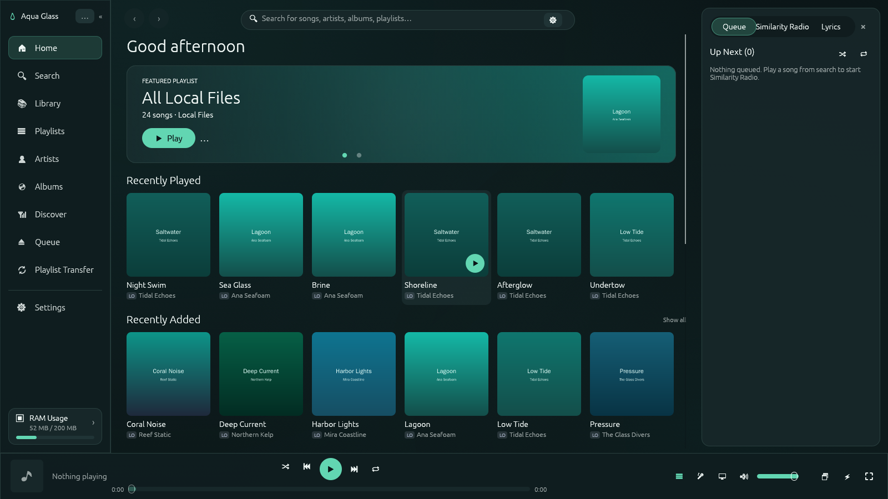
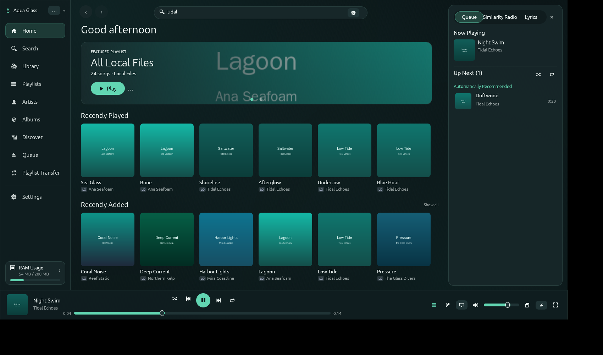

# Aqua Glass

A native, lightweight music client for Windows 11 written in Rust (egui/eframe + OpenGL).
It combines your **Spotify** library (with Premium playback) and **local files** in one
interface, with a
searchable settings menu where every optional feature can be switched off and shows its
RAM impact.

* No Electron, no Chromium, no embedded browser, no helper processes.
* Measured: **~41–42 MB private memory idle / during playback, ~43–45 MB with the richest
  presets**, Similarity Radio ≈ +0.1 MB (Linux development environment, see
  [Benchmarks](docs/BENCHMARKS.md)). The default soft target is 200 MB.
* **Automatic Similarity Radio**: play one song from search and similar songs keep coming.
* No telemetry, no analytics, no ads. Tokens live in Windows Credential Manager.

> **Status — please read.** Everything listed under "Verified" below was compiled, run and
> tested in this repository's development environment (Linux, virtual display, null audio
> sink). The Windows `.exe` is cross-compiled from Linux and was smoke-tested under
> **Wine 9** (UI, portable mode, tray icon, global hotkeys, local playback via WASAPI,
> auto-advance, command-line files) but has **not yet been run on a real Windows 11
> machine**; Spotify sign-in/playback has **not been tested
> against the live services** (no accounts or network access to those services were
> available while building). See [Known limitations](#known-limitations).

---





## Contents

1. [Installing](#installing)
2. [Connecting your services](#connecting-your-services)
3. [What works with which service](#what-works-with-which-service)
4. [Using Aqua Glass](#using-aqua-glass)
5. [Similarity Radio](#similarity-radio)
6. [Settings, RAM ratings and presets](#settings-ram-ratings-and-presets)
7. [Privacy and security](#privacy-and-security)
8. [Building from source](#building-from-source)
9. [Testing and benchmarking](#testing-and-benchmarking)
10. [Architecture](#architecture)
11. [Known limitations](#known-limitations)

Further reading: [Configuration reference](docs/CONFIGURATION.md) · [Testing Similarity Radio with Last.fm](docs/TESTING-LASTFM.md) ·
[Benchmarks](docs/BENCHMARKS.md) · [Changelog](CHANGELOG.md)

---

## Installing

Aqua Glass is a single portable executable — no installer, no admin rights.

1. Unzip `aqua-glass-windows-x64.zip` anywhere (e.g. `C:\Users\you\Apps\AquaGlass`).
2. Run `aqua-glass.exe`.

Data (settings, library cache, themes, transfer backups) is stored in
`%APPDATA%\AquaGlass`. For a fully portable setup, create an empty file named
`portable.txt` next to the exe; data then goes to a `data` folder beside it.

Command line:

| Argument | Effect |
|---|---|
| `aqua-glass.exe song.mp3 other.flac` | Play these files (works with "Open with…") |
| `--minimized` | Start in the tray (or minimized if the tray is off); used by "Start with Windows" |
| `--page <home\|search\|library\|now-playing\|queue\|transfer\|settings\|performance>` | Start page |

## Connecting your services

### Spotify

Settings → Music Services → **Sign in with Spotify**. Your browser opens Spotify's normal
login page (OAuth 2.0 with PKCE, redirect to `http://127.0.0.1:8898/login`). No passwords or
cookies are ever entered into Aqua Glass.

* **Playback requires Spotify Premium** — this is enforced by Spotify. Library import,
  synchronization, search, export and transfer also work with Free accounts.
* **Playback goes through Spotify Soloist** (default since 0.7), Spotify's official
  headless player. See [Spotify playback with Soloist](#spotify-playback-with-soloist) below.
  The older built-in [librespot](https://github.com/librespot-org/librespot) player
  remains as an option. It is unofficial, and since late 2025 Spotify refuses its audio
  keys for many accounts, so songs skip without playing; Aqua Glass now detects this and
  says so. There is no DRM circumvention in Aqua Glass.
* **Rate limiting.** Spotify limits Web API requests *per app*. By default Aqua Glass uses
  librespot's public app, whose quota is shared with every librespot-based player, so heavy
  use elsewhere can get it throttled. Aqua Glass:
  * paces its requests;
  * pauses all Spotify calls for exactly as long as Spotify asks (`Retry-After`), showing
    "Spotify paused N s" in the sidebar;
  * skips unchanged playlists and collections when syncing, and caches lookups.

  If you still see throttling, **use your own Spotify app** (next point): library, search
  and sync then use your private quota. Playback isn't affected by Web API rate limits.
* Optional, recommended: use your own Spotify Developer app (Settings › Music Services ›
  "Use your own Spotify app"). Aqua Glass then signs in twice once: your app for the Web
  API, librespot's for playback.
  Register `http://127.0.0.1:8898/login` as redirect URI. Since **February 2026** Spotify
  Development-Mode apps need a Premium owner, are limited to 5 users, and have a reduced
  endpoint set (e.g. playlist `tracks` renamed to `items`; some catalog endpoints
  removed). Aqua Glass understands both the old and new response formats. librespot
  playback may reject tokens from custom client ids.
* Disconnecting deletes the stored refresh token. Spotify has no API to revoke a grant;
  remove the app at <https://www.spotify.com/account/apps/> to revoke it fully.

### YouTube Music (removed in 0.6)

YouTube Music support was removed in version 0.6. Google offers no audio API for
third-party apps, so YouTube songs could only open in the browser. On the first start of
0.6, Aqua Glass deletes the stored Google credentials, the cached YouTube library and
YouTube plays from the listening history. To keep YouTube Music playlists, *before*
upgrading use Playlist Transfer in 0.4.x to copy them to Spotify or export them as
JSON/CSV; 0.6's Playlist Transfer can import those files and match them on Spotify.
(Google Takeout's playlist CSVs contain only video ids, not titles, so they can't be
matched.)

### Spotify playback with Soloist

[Spotify Soloist](https://developer.spotify.com/documentation/soloist) is Spotify's
official headless Spotify Connect player. It runs as a separate background program
(no window) and plays the audio. Aqua Glass stays your only music interface: it keeps
its own queue, manual-queue priority and Similarity Radio, and tells Soloist which song
to play over Soloist's local WebSocket API.

Setup, once (Settings › Music Services › Spotify playback):

1. Download the **Windows x86_64** build from Spotify's
   [downloads page](https://developer.spotify.com/documentation/soloist/reference/downloads-and-updates)
   and extract the ZIP. Aqua Glass never bundles or redistributes Soloist.
2. Generate your **Soloist API key** at <https://developer.spotify.com/dashboard/soloist>
   (needs Premium; the key is for you only).
3. In Aqua Glass choose `soloist.exe`, paste the key and click **Save securely**. The key is
   stored in Windows Credential Manager. Aqua Glass starts Soloist in the background.
4. **Pair once:** open Spotify on your phone or PC (same network), tap the devices icon and
   choose **Aqua Glass**. Soloist remembers the pairing in its data folder
   (`<Aqua Glass data>\soloist`).

Details:

* **Updates:** Soloist builds stop working **90 days** after their build date (exit code
  10). Settings shows the days left and warns two weeks ahead. To update, download the
  new ZIP and replace `soloist.exe`. Keep the same data folder and it stays paired.
* **Security:**
  * Aqua Glass always starts Soloist with `--ws 127.0.0.1:0` and refuses to connect to a
    non-local address; Soloist's control socket has no authentication of its own.
  * Soloist accepts its API key only on the command line, so other programs on the PC
    that can list processes could read it while Soloist runs (a Soloist limitation).
  * Soloist announces itself on the local network for Spotify Connect pairing.
  * Aqua Glass ties Soloist to a Windows job object, so it also stops if Aqua Glass
    crashes.
* **What differs from in-app playback:**
  * Soloist outputs audio itself, so Aqua Glass' EQ, visualizer, normalization and
    crossfade don't apply to Spotify songs.
  * Songs don't play gaplessly: there is a short gap between songs.
  * The volume slider sets Soloist's volume.
  * Pausing or skipping from the Spotify app is reflected in Aqua Glass.
* **Memory:** Soloist is a separate process. The Performance page shows its memory and the
  combined total next to the 200 MB target. Measured here with the official Linux x86_64
  build, idle and unpaired: about 25 MB resident (≈3 MB of it private). Memory while
  streaming and on Windows has **not been measured yet**.

### Portrait mode

When the window is narrower than 720 px, or clearly taller than it is wide (height at
least 1.4 × width, e.g. maximized on a vertical 1080×1920 monitor), Aqua Glass switches
to a single-column **portrait layout** (Auto). It switches back above 800 px wide or below
1.25 × width tall. You can also force *Landscape* or
*Portrait* in the "…" menu or Settings › General; forcing portrait resizes the window to a
phone-like column and restores the previous size afterwards. The portrait screen has:

* a header with the RAM indicator, search and settings;
* the **Playing** screen: large artwork, clickable title (album) and artist (artist page),
  like, progress, the player controls, and one **Queue / Lyrics / Discover** tab at a time;
* a mini player on other pages, and a bottom bar (Playing, Home, Search, Library).
* a full-width search field at the top of the Search page (tapping Search puts the cursor
  in it).

It is the same app underneath: the player, music services, Similarity Radio, library and
artwork cache are shared, so switching never starts anything twice and playback continues
uninterrupted. Only what is visible is built:

* no sidebar, side panel or visualizer (the audio tap stays off);
* only the active tab is drawn, and the tab you picked is remembered;
* the queue is virtualised: only visible rows exist and load artwork, even with 500 songs
  queued;
* covers not on screen are released whenever the layout switches.

Measured memory for both layouts is in [docs/BENCHMARKS.md](docs/BENCHMARKS.md).

### Equalizer

The EQ is built into Aqua Glass and needs no other software. Settings › Audio has:

* the 10-band EQ (31 Hz–16 kHz, ±12 dB) and its presets;
* bass boost (a 120 Hz shelf);
* pre-amp and balance.

Processing runs as `pre-amp → EQ bands → bass shelf → balance`, inside Aqua Glass' own
audio output, before the audio is handed to Windows:

* Changes are heard within one audio callback (about 10 ms) and glide over about 10 ms,
  so dragging a slider doesn't click.
* With the EQ off and everything flat, the audio is passed through untouched.
* It only affects Aqua Glass' own audio, never other apps, the microphone or system
  settings. Measured on a shared device: another app's sound was unchanged to 0.01 dB.

What it doesn't cover:

* **Spotify songs played by Spotify Soloist.** Soloist sends its audio straight to Windows,
  so no EQ inside Aqua Glass can reach it. The EQ applies to local files, and to Spotify
  with the optional librespot backend.
* **Clipping protection lowers nothing by itself.** If the boosts push peaks over full
  scale, those peaks are gently soft-clipped. The settings page tells you how far to lower
  the pre-amp to avoid that.

Aqua Glass no longer reads or changes Equalizer APO's files (versions 0.7.3–0.8 could
drive it). If you connected Equalizer APO earlier, its `config.txt` still contains the
line `Include: aqua-glass.txt`. Settings › Audio shows a one-time note about it. To
remove it, delete the line in Equalizer APO's Configuration Editor, or restore
`config.txt.before-aqua-glass`.

### Local files

Settings → Music Services → Local files → add a folder. MP3, FLAC, Ogg Vorbis, WAV and
AAC/M4A are decoded natively. ReplayGain track gain is applied when "Volume
Normalization" is on.

## What works with which service

| Capability | Spotify | Local |
|---|---|---|
| Sign-in | OAuth PKCE (browser) | — |
| Playlists (own + followed), order, descriptions, artwork | ✔ | folder scan |
| Liked songs | ✔ | — |
| Saved albums, followed artists | ✔ | albums from tags |
| Recently played | ✔ | — |
| Search | ✔ | ✔ |
| Artist / album pages | ✔ | albums |
| **Playback inside Aqua Glass** | ✔ **Premium**, via librespot | ✔ |
| Play / pause / seek / next / previous / queue / shuffle / repeat | ✔ | ✔ |
| Like a track | ✔ | — |
| Create playlist / add tracks (transfer target) | ✔ | — |
| Lyrics (LRCLIB) | ✔ | ✔ (needs artist tag) |
| EQ, visualizer, normalization, gapless | ✔ | ✔ |

For a local file, **"Find on Spotify…"** looks up the same recording on Spotify. You always
choose; recordings are never swapped silently.

## Using Aqua Glass

* **Layout** (after the Aqua Glass concept design):
  * a collapsible sidebar with pill navigation (Home, Search, Library, Playlists, Artists,
    Albums, Discover, Queue, Playlist Transfer, Settings) and the RAM Usage card;
  * a top bar with back/forward and a centred search pill (its ⚙ button sets the service
    filter and shows account status);
  * the main content area and the persistent bottom player;
  * an optional right panel with Queue / Similarity Radio / Lyrics tabs, shown only when
    you open it. Click the artwork in the player for the
  Now Playing page. There are no social features.
* **Home** shows a featured banner (from your own playlists or top mix), Recently Played, Favorite Playlists, Made For You (Spotify-made playlists
  you follow), Recently Added, Your Top Mixes, Discover New Music, Recently Imported Spotify
  Playlists and Local Music — each row appears only when there is real data for it.
* **Service filter** (top bar): All / Spotify / Local. Disabled services do no background work.
* **Library import & sync** (Library page / Settings → Library & Synchronization):
  * *Accessing* a playlist reads it live from the service.
  * *Importing* caches it locally (`%APPDATA%\AquaGlass\library`) and keeps it in sync;
    "Import all playlists" or tick individual playlists.
  * *Sync Now* or automatic sync (interval configurable). Unchanged playlists are skipped
    using their snapshot ids; 429 rate limits are honoured with back-off.
  * Sync is **read-only** towards your account. Playlists deleted/unfollowed upstream are
    kept locally and flagged for review; a sudden large shrink is flagged and the previous
    copy is backed up.
* **Playlist Transfer:** choose a source playlist (any service, or restore from a
  JSON/CSV/M3U file), choose a destination, preview matches (matched / ambiguous /
  unmatched with scores and reasons such as "version differs: live"), pick replacements
  manually, rename, and create. The source is never modified; a JSON backup and a log are
  written to `transfers\`, and you can remove a created playlist again from the history.
* **Export:** any playlist to JSON (full metadata, re-importable), CSV or M3U.
* **Volume** is in every layout: player bar, portrait (under the controls), mini-player and
  Essential Mode. Click the speaker to mute, scroll over it to change the volume (a step
  per wheel notch), and hover or drag to see the percentage. All layouts show the same
  level, and it applies to whichever backend is playing (Soloist included).
* **Mini-player** (button in the playback bar, tray menu or `Ctrl+Alt+N`): three
  layouts, opacity, always-on-top, remembers position and size, optional lyric line.
* **Desktop overlay:** transparent always-on-top window with title, artist, artwork,
  current lyric and progress; position/size/opacity/font size; click-through.
* **Keyboard:** `Space` play/pause, `Ctrl+,` settings, `Ctrl+F` search, plus every action
  in Settings → Keyboard Shortcuts (with conflict detection). With "Global Hotkeys" on,
  they work system-wide; macro pads that send key combinations (e.g. F13–F24) work as-is.
  Hardware media keys and the Windows media flyout work via "Windows Media Controls".

### Essential Mode

For gaming, working or listening for hours with nothing else on screen. Essential Mode
turns the window into a small bar with **only** the current song title, shuffle,
previous, play/pause, next, repeat and the volume (with mute). The window can be resized;
from about 600 px wide everything sits in one row.

* **Enter it** with `Ctrl+Shift+M` (configurable in Settings › Keyboard Shortcuts), from
  Settings › Appearance › Layout, the "…" menu next to the logo, or the tray menu (Windows).
  **Leave it** with the same shortcut or the ⤢ button in its corner.
  * The shortcut works while Aqua Glass has focus. It is deliberately not a system-wide
    hotkey: `Ctrl+Shift+M` is used by other apps (for example Discord's mute).
* **It releases resources, not just hides them:**
  * cover-art textures and decoded images, and background images;
  * page data (live playlists, artist pages, search results, other songs' lyrics) and
    in-memory playlist track lists (they stay on disk);
  * the visualizer's audio feed.

  It also suspends lyrics requests, library auto-sync, the animated background, UI
  animations and the mini-player/overlay windows. The window only redraws when something
  changes, plus a 5-second housekeeping tick.
* **Everything that plays keeps working:** playback and track changes, the queue,
  Similarity Radio (it runs on its own thread and keeps refilling), global hotkeys, media
  keys, listening history and the EQ.
* **Leaving restores** the previous window size, position and layout, the page you were
  on, the theme and animations. Covers and pages reload as you look at them. Nothing in
  your settings is changed by entering it.
* **Options** (Settings › Performance › Essential Mode, all off unless noted):
  * enter after N minutes without using the Aqua Glass window;
  * enter when the window is minimized;
  * restore the previous layout on exit (on);
  * always on top;
  * remember the Essential window size (on).
* **Measured:** CPU use drops about 5.6× (1.65 % vs 9.3 % of one core), and memory drops by
  what you had loaded (−2.8 MB from Now Playing, −4.0 to −4.5 MB after browsing a page of
  album covers). The rest of Aqua Glass's ≈45 MB is fixed
  cost: renderer, fonts and audio. See [docs/BENCHMARKS.md](docs/BENCHMARKS.md).

### Artist pages

Click an artist anywhere — the player bar, Now Playing (both layouts), track rows in
search results, playlists, albums and the queue, an album's header, or a search result —
to open the artist page. Spotify artists show:

* artwork, name and genres (Spotify marks genres deprecated, so they may be empty);
* Play / Shuffle;
* **Popular on Spotify** — Spotify removed its "artist top tracks" endpoint in February
  2026, so these are Spotify's best search matches credited to the artist;
* **Albums** and **Singles and EPs**;
* with a Last.fm key: a **listeners and plays** line under the name, **Similar artists**,
  and an **About** biography. These are Last.fm's all-time figures. Spotify's "monthly
  listeners" number isn't available to apps through any official API, and reading it from
  Spotify's website would mean scraping it, so Aqua Glass doesn't show it.

Spotify no longer provides related artists, follower counts or popularity, so they
aren't shown. Each section loads on its own: if one fails, the rest still shows with a
note, and a **Retry** button reloads the page. **Local artists** get a page from your
files: their songs, albums and Play / Shuffle.

## Similarity Radio

Play a single song from search results and Aqua Glass starts **Similarity Radio**
automatically (Settings › Playback › Similarity Radio; on by default). The song plays
immediately; ~15 similar, *playable* songs are added to the "Automatically Recommended"
part of the queue in the background and refilled when fewer than 5 remain.

* **Source of similarity:** [Last.fm](https://www.last.fm/api)'s public similarity data
  (`track.getSimilar`, `artist.getSimilar`, `artist.getTopTracks`). It needs a free API key:
  create one at <https://www.last.fm/api/account/create> and paste it in Settings ›
  Playback › Similarity Radio (stored in Credential Manager). Only the seed's artist/title
  and related artist names are sent; no Last.fm account or scrobbling.
* **Without a key** the radio falls back to songs by the same artist / from the same album
  (local library and Spotify) and labels itself "Artist & album based". It never invents
  recommendations.
* **Playable only:** each candidate is matched to a track you can actually play — your local
  library first, then Spotify (when Premium playback is ready) using the same strict
  matching as playlist transfer (no live/remix/cover substitutions). Unmatched candidates
  are dropped.
* **Discovery strength:** *Familiar* (the seed's closest similar tracks), *Balanced* (plus the
  best-known songs of the 6 closest related artists), *Adventurous* (artists 4–24 in the
  related-artist list, seed artist down-weighted), *Deep Discovery* (artists 10–60, their
  less popular tracks, popularity-penalised, seed artist and songs you've heard excluded).
* **Rules:** Prefer Unheard, Avoid Recently Played (7 days), Avoid Duplicates (per session),
  Allow Repeated Artists (off = one per artist per batch, not within the last 4), Learn From
  Likes and Skips (3 skips drop an artist for the session — never the seed's artist; likes
  boost an artist and steer the seed), Stay Close to Original (otherwise the seed follows
  the radio), Endless Radio, target size and refill threshold, preferred provider.
* **Queue behaviour:** songs you add with "Add to queue" always play before recommendations;
  playing a playlist or album never gets radio mixed in (with "Activate from Album/Artist
  Pages" on, recommendations follow *after* the album). Controls in the right panel:
  Radio on/off, Refresh, More Like This, Stay close to original, Save queue as playlist
  (Spotify playlist for Spotify songs, M3U file for the rest).
* **Footprint:** one worker thread that only exists while the feature is on, woken by queue
  changes (no polling); bounded caches (48 Last.fm responses); measured ≈ +0.1 MB.
* Listening history (last 500 plays, `history.json`) stays on your PC and can be cleared.

## Settings, RAM ratings and presets

Open settings with the always-visible **⚙ Settings** button, `Ctrl+,`, the tray menu, the
☰ application menu, or the ⚡ quick-settings button. The last category is remembered, and
the search box finds settings by name, description, category or keywords — e.g. "RAM",
"lyrics", "equalizer", "background".

Every optional feature (78 of them) has its own toggle, description, dependency info and a
RAM badge:

```
[✔] Blurred Background
    RAM: LOW   Estimated: +0.5–4 MB          ← engineering estimate (not yet measured)
[✔] Custom Background Image
    RAM: HIGH  Measured: +16.4 MB             ← measured on *your* PC
```

* **Estimated** values come from the table in `src/features.rs`, calibrated with the
  benchmark in [docs/BENCHMARKS.md](docs/BENCHMARKS.md).
* **Measured** values are recorded automatically on your machine: when you enable a
  feature, Aqua Glass reads the private working set before and ~6 s after, and keeps a
  running mean per feature (Settings → Performance → "Measured feature costs on this PC").
* Ratings: Low ≤ 5 MB · Moderate ≤ 15 MB · High ≤ 35 MB · Very High > 35 MB.
* The Performance page shows live private working set, peak, private bytes, CPU, cache
  sizes, FPS, background tasks, and a combined estimate of enabled features that counts
  shared resources (one background texture) only once.
* **RAM target** (default 200 MB; 100/150/200/250/300/custom) is a *soft* target. With the
  "Automatic Memory Optimizer" on, Aqua Glass halves the artwork cache at 85 %, and above
  100 % lowers artwork resolution, drops caches and hidden track lists, frees the
  visualizer and asks Windows to trim the working set. It never stops playback, kills
  itself or discards data. "RAM Warnings" asks before enabling a feature that may exceed
  the target (*Enable Anyway* / *Cancel*).
* **Presets:** Minimal, Balanced (default), Enhanced, Fully Customized, Custom. Save, apply,
  export and import your own presets. Presets never touch accounts or library data.
* **Disable All Visual Customizations** turns off every visual feature while keeping
  playback, accounts, libraries, playlists and playback preferences; **Restore previous
  customization profile** undoes it.
* Settings save automatically (`settings.toml`), can be exported/imported (never
  containing credentials), reset per feature, per category or completely.

## Privacy and security

* No telemetry, analytics or advertising SDKs. Crash reports (0.4.1+) are written only to
  a local file; nothing is uploaded.
* Network access only to: Spotify (accounts/api/CDN/access points), image CDNs for
  artwork, Last.fm (Similarity Radio, when a key is set) and lrclib.net for lyrics (when Lyrics is on:
  sends title, artist, album, duration).
  The full table is in Settings → Privacy.
* OAuth refresh tokens and the Last.fm key are stored in **Windows Credential
  Manager** (`AquaGlass/...`), never in files, logs or exports. Error messages are scrubbed
  of token-like strings.
* Diagnostic logging is off by default.
* "Disconnect" deletes stored tokens; optionally deletes
  the cached library.

## Building from source

Requirements: Rust 1.85+.

```bash
# native (Windows, MSVC or GNU toolchain)
cargo build --release
```

Cross-compiling from Linux (how the provided exe is built):

```bash
rustup target add x86_64-pc-windows-gnu
sudo apt-get install mingw-w64
cargo build --release --target x86_64-pc-windows-gnu
```

Note: `vergen` is pinned to 9.0.6 in `Cargo.lock` because librespot-core 0.8's build script
fails with vergen 9.1 (`cargo update -p vergen --precise 9.0.6` if you regenerate the lockfile).

Optional modules are Cargo features, so a build can leave them out entirely (runtime
toggles only stop them):

| Feature | Default | Contents |
|---|---|---|
| `spotify-playback` | ✔ | librespot (Spotify Premium playback) |
| `local-files` | ✔ | symphonia decoders for local files |
| `accessibility` | ✖ | AccessKit screen-reader support |

```bash
# smallest build: local files only
cargo build --release --no-default-features --features local-files
```

`scripts/package-windows.sh` builds the release exe and the zip.

## Testing and benchmarking

```bash
cargo test --workspace           # unit + integration tests (all crates)
scripts/check-portable.sh        # portable crates have no UI/audio/OS deps; aqua-core builds for Android
```

* 111 unit tests across the workspace (including Similarity Radio and its live self-test harness: the four discovery modes differ as specified,
  duplicate/artist/recently-played/skip/like rules, unplayable candidates dropped, Last.fm
  response parsing, history bounds), plus: config persistence/migration/invalid files, feature registry and
  presets, disable/restore visuals, shortcut parsing and conflicts, theme loading and
  validation, Spotify response parsing (both 2026 and older field names), API
  error classification, OAuth PKCE (RFC 7636 vector), library import/sync/conflicts/
  corrupted cache, track matching (live/remix/cover/remaster/feat.), JSON/CSV/M3U
  round-trips, transfer planning/execution with a fake service, queue logic incl. a
  20,000-track shuffle, DSP (EQ gain at 1 kHz, bass shelf, balance, resampler),
  lyrics parsing (LRC, offsets, word timing), visualizer FFT.
* `tests/radio_e2e.rs` runs the real engine, audio output, library store and radio worker:
  radio starts from a played song, fills to 15, a manually queued song plays before the
  recommendations, the queue refills before running out, no duplicates, Stop clears only
  the recommendations.
* `tests/playback.rs` plays generated audio through the real decoder → DSP → audio output →
  engine: auto-advance (gapless and not, including a track shorter than the buffer), seek,
  pause, end of queue, missing files, Spotify without a session. It needs an audio device
  (on Linux CI: PulseAudio with `module-null-sink`); it skips when none exists.
* Sync model (`crates/aqua-core`): serialization round trips, schema-version checks, a frozen
  schema-1 fixture that must keep decoding and re-encoding identically, queue-state
  preservation (manual items stay ahead of radio items after a round trip), deterministic
  merges for like/unlike and two-device playlist edits, reconnect-after-days history merge,
  handoff planning, no secrets or local paths in payloads.
* `bench/run_bench.py` and `bench/soak.py` reproduce the memory benchmarks; see
  [docs/BENCHMARKS.md](docs/BENCHMARKS.md) for the procedure, environment and results.

## Architecture

The repository is a Cargo workspace. The Windows desktop app is the root package; code
that a future Android client (or a sync server) can reuse lives in platform-independent
crates. See [docs/future-mobile-architecture.md](docs/future-mobile-architecture.md).

```
crates/
  aqua-core/         portable core (no UI/audio/OS deps; compiles for aarch64-linux-android)
    model.rs         provider-neutral Track / Playlist / Album / Artist, ProviderKind
    queue.rs         play queue: order, shuffle, repeat, Context/Manual/Radio entry origins
    playback.rs      PlaybackControl trait (platform audio implements it), PlayerState
    history.rs       local listening history (bounded)
    library.rs       import cache, snapshot-based sync, conflicts, backups
    matching.rs      cross-service track matching
    prefs.rs         portable Similarity Radio preferences
    session.rs       saved "remember queue" session (keeps entry origins)
    sync/            versioned cross-device sync + handoff data model (no networking)
    secrets.rs, storage.rs, platform.rs   hooks the platform fills in (secret store,
                     data directory, browser launcher)
  aqua-providers/    oauth (PKCE loopback), spotify (Web API), lastfm,
                     lyrics, shared rate limiter — reqwest + rustls, no OS APIs
  aqua-radio/        Similarity Radio: gather (Last.fm) → rank/filter → resolve → queue
                     refill, driven through PlaybackControl
src/                 Windows desktop app
  main.rs            entry point (windows_subsystem in release)
  lib.rs             run(): CLI, window options
  util.rs            data directory, platform hook installation, logging
  config.rs          settings.toml model, versioned migration, import/export, presets
  features.rs        registry of every optional feature (id, text, RAM estimate, deps, presets)
  perf.rs            Windows process metrics, per-feature measurement, memory pressure
  security.rs        Windows Credential Manager secret store
  syncprep.rs        desktop ↔ sync model conversion, --export-sync-snapshot
  transfer.rs        JSON/CSV/M3U export/import, transfer plan + execution + logs
  theme.rs           declarative TOML themes → egui style
  shortcuts.rs       actions, binding parser, conflict detection
  artwork.rs         downscaling image loader, LRU texture cache with byte budget, blur
  winint.rs          tray, SMTC media controls, global hotkeys, autostart, toasts, acrylic
  model/history/library/matching/radio/services.rs   re-exports of the portable crates
  audio/
    output.rs        single cpal/WASAPI output: ring buffer, volume, fades, visualizer tap
    dsp.rs           native EQ: lock-free settings, f64 biquads, smoothing; resampler
    engine.rs        playback engine thread (implements PlaybackControl), gapless hand-off
    spotify.rs       librespot session + custom Sink into our output
    local.rs         symphonia decoding, tag probing, folder scan
    visualizer.rs    FFT analyzer (runs only while visible)
  ui/                shell (sidebar/top bar/player/right panel), browse (home/search/discover/
                     now playing/queue), pages (library views), settings, transfer, viewports
```

Key decisions:

* **One audio pipeline.** librespot's decoded PCM goes through a custom `Sink` into the
  same output, DSP and visualizer tap as local files.
* **Playback is independent of the UI.** The engine runs on its own thread, so queue
  advance, media keys, tray actions and notifications keep working while the
  window is minimized or hidden. `App::logic` processes background messages even when the
  window is hidden.
* **Repaint only on change.** Idle UI does not redraw; playback repaints twice a second for
  the progress bar; only visible animations (visualizer, animated background, transitions)
  request higher frame rates.
* **Everything optional is lazily created and dropped**: tray, hotkey
  registrations, media controls, analyzer, background textures, overlay/mini windows.

## Known limitations

Honest list of what is not done or not verified:

* **Not yet run on real Windows 11.** The exe is cross-compiled (MinGW) and imports only
  standard system DLLs. Under Wine 9 the UI, tray icon, global-hotkey registration, WASAPI
  playback and portable mode worked; SMTC/media flyout, Credential Manager, toasts,
  registry autostart and DWM acrylic were not exercised (Wine doesn't implement them
  faithfully), and Wine doesn't report private memory counters (the dashboard says so). The Windows memory figures in
  the app come from Windows itself; the numbers in docs/BENCHMARKS.md are from Linux.
* **Soloist playback has not been heard end to end here.** The integration was run against
  the real Soloist binary (start, local API, events, refusal before pairing, shutdown), and
  the engine against a protocol-accurate fake. Pairing and actual streaming need a Premium
  account and a Soloist API key, which the build environment doesn't have.
* **Spotify was not tested against the live service** (no credentials or
  network route to them in the build environment). Parsing is tested against fixtures that
  follow the documented response formats, but end-to-end sign-in, sync, playback and
  transfers need verification with real accounts.
* **Similarity Radio has not yet run against real Last.fm responses**: the build sandbox
  blocks `ws.audioscrobbler.com`. Parsing is tested against Last.fm's documented JSON, the
  pipeline against a deterministic similarity graph, and the end-to-end flow (start from
  search, fill, refill, manual priority, no duplicates) with the artist/album fallback and real
  audio. To run the live checks on your PC (in-app button, `--radio-selftest`, or
  `cargo test --test lastfm_live -- --ignored`), see **[docs/TESTING-LASTFM.md](docs/TESTING-LASTFM.md)**.
* The interface follows the supplied Aqua Glass concept image. The window keeps the native
  Windows title bar (with dark mode) instead of the concept's custom-drawn one.
* Not implemented: crossfade, WASAPI exclusive mode, lyric translations, lyric blur/
  position/animation-speed options, taskbar thumbnail toolbar buttons, raw HID
  macro-pad support (key-sending macro pads work), visualizer placement options other
  than Now Playing / player bar.
* The "Windows 11 Acrylic Backdrop" depends on the GPU driver supporting a transparent
  OpenGL surface; it is experimental and needs a restart.
* Notifications use the PowerShell AppUserModelID because the portable exe isn't
  registered with Windows; the toast therefore shows "Windows PowerShell" as the source.
